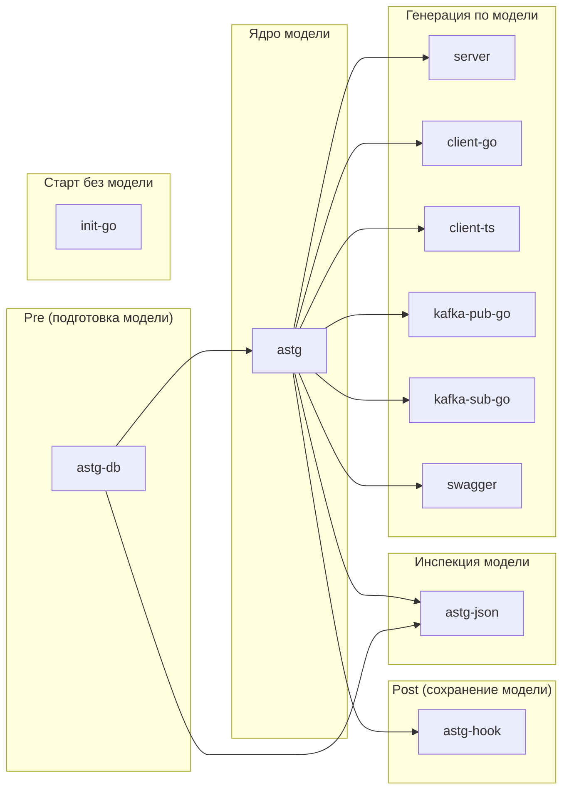
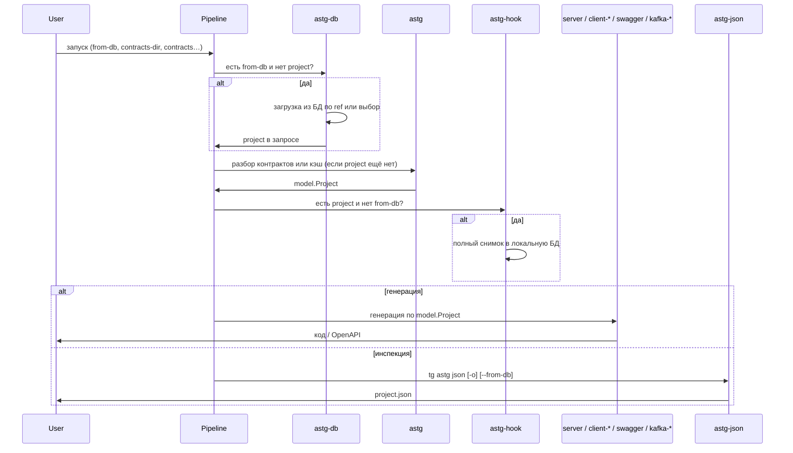

# Плагины для генерации кода (tgp-go)

Набор плагинов для системы [tg](https://github.com/seniorGolang/tg/v3) (Tool Gateway): генерация серверного и клиентского кода, документации API и заготовок проектов на основе Go-интерфейсов с аннотациями `@tg`.

Все плагины работают с **единой моделью проекта** (контракты, типы, методы, аннотации). Модель строит плагин **astg**; остальные либо подготавливают/сохраняют её, либо генерируют по ней код и документацию. Полные руководства — `tg plugin doc <имя>`.

---

## Роли плагинов и связи



- **astg** — единственный источник модели из исходников: контракты `@tg`, типы, аннотации, кэш.
- **astg-db** / **astg-hook** — загрузка и сохранение снимков в локальной базе контрактов (`from-db`).
- **astg-json** — экспорт resolved-модели в JSON (`tg astg json`), локально или из БД.
- **server**, **client-go**, **client-ts**, **kafka-pub-go**, **kafka-sub-go**, **swagger** — генерация по уже собранной модели.
- **init-go** — bootstrap нового Go-проекта без существующей модели.

---

## Поток данных в пайплайне



---

## Плагины: суть и возможности

Краткие указатели. Каталоги аннотаций, опции и edge cases — только в `tg plugin doc <плагин>`.

### astg

Парсер Go-проекта и SSOT по смыслу `@tg`: layout `contracts/` + `contracts/dto`, уровни/приоритет, sub-аннотации, полный каталог, security/mapping, wire-форма (enums, inline, opaque JSON), матрица влияния на генераторы. Опции пайплайна `contracts-dir` / `no-cache`; `--contracts` снимок не сужает. Отладка модели — через `astg-json`.

### astg-db

Pre: модель из локальной БД по `from-db` (ref, интерактив, `all-contracts`). Фильтр загруженной модели — контракты **в ref**; `--contracts` у генератора лишь глушит UI выбора (урезание для кода — у самого command-плагина). Ключ проекта = то, что записал hook (нормализованный remote/module), а не произвольное короткое имя.

### astg-hook

Post: полный снимок после локального разбора. Версия: тег → ветка → `default`. Skip при `from-db`. Ошибки БД best-effort (debug, пайплайн не валится); проверка записи — `tg astg json --from-db`.

### astg-json

Команда `tg astg json [-o файл] [--from-db …]`: экспорт resolved JSON для инспекции и сравнения local vs DB. `all-contracts` по умолчанию true. Пишите в файл и запрашивайте точечно — не сбрасывайте весь JSON в чат.

### server

Fiber-сервер: HTTP REST, JSON-RPC 2.0 (batch), WS/SSE streams. Маршруты и mapping (`explicit`/`implicit`/`body`) из аннотаций; Auth/bearer, health/shutdown; опциональные log/metrics/trace.

### client-go

Типобезопасный Go-клиент: JSON-RPC, REST, WS/SSE; batch; Auth / ResourceTokens / TokenSource; upload/download; метрики latency.

### client-ts

TypeScript-клиент (browser/Node): RPC и HTTP accessors, batch, Blob/FormData, streams (`signal`/`onReady`), identity/`X-Client-Id`, опциональная NPM-мета из пакетных аннотаций.

### kafka-pub-go / kafka-sub-go

Издатель и подписчик на franz-go по единым контрактам `@tg kafka`: кодеки, `kafka-acks`, sync produce; у sub — plain/Meta/Slice/Batch handlers, commit/offset reset, наблюдаемость. Пакет вывода — basename `--out`.

### swagger

OpenAPI 3.0 по контрактам (HTTP/JSON-RPC/WS/SSE в одной спеке; Kafka опущен): схемы, parameters, security, JSON/YAML, встроенный `--serve` для Swagger UI.

### init-go

Scaffold Go-модуля с контрактами (JSON-RPC и/или REST) и заглушками сервисов; транспорт/OpenAPI достраиваются через `go generate ./...`. Не для дописывания контрактов в уже существующий сервис.

---

## Типичные сценарии

| Задача | Куда смотреть |
| ------ | ------------- |
| Написать/править контракты `@tg` | `tg plugin doc astg` (+ skill `tgp-contracts`) |
| Проверить resolved-модель | `tg astg json -o .tg/project.json` → `tg plugin doc astg-json` |
| Сгенерировать Fiber-сервер | `tg plugin doc server` |
| Go / TS клиент | `tg plugin doc client-go` / `client-ts` |
| OpenAPI / Swagger UI | `tg plugin doc swagger` |
| Kafka pub/sub | `tg plugin doc kafka-pub-go` / `kafka-sub-go` |
| Сохранить модель в БД | пайплайн с `astg-hook` → `tg plugin doc astg-hook` |
| Генерировать из БД | `--from-db` → `tg plugin doc astg-db` |
| Новый репозиторий с нуля | `tg plugin doc init-go` |

Минимальный цикл после правки контрактов: экспорт модели → нужные генераторы → сборка потребителей. Не править сгенерированные деревья вместо аннотаций.

---

## Установка и документация

Требуется платформа [tg](https://github.com/seniorGolang/tg/v3):

```bash
go install github.com/seniorGolang/tg/v3/cmd/tg@latest
```

Установка плагинов (все или выборочно):

```bash
tg pkg add https://github.com/seniorGolang/tgp-go
tg pkg add https://github.com/seniorGolang/tgp-go:server
tg pkg add https://github.com/seniorGolang/tgp-go:client-go
tg pkg add https://github.com/seniorGolang/tgp-go:client-ts
tg pkg add https://github.com/seniorGolang/tgp-go:kafka-pub-go
tg pkg add https://github.com/seniorGolang/tgp-go:kafka-sub-go
tg pkg add https://github.com/seniorGolang/tgp-go:swagger
tg pkg add https://github.com/seniorGolang/tgp-go:init-go
tg pkg add https://github.com/seniorGolang/tgp-go:astg
tg pkg add https://github.com/seniorGolang/tgp-go:astg-db
tg pkg add https://github.com/seniorGolang/tgp-go:astg-hook
tg pkg add https://github.com/seniorGolang/tgp-go:astg-json
```

```bash
tg plugin doc <имя-плагина>
# astg | astg-db | astg-hook | astg-json | server | client-go | client-ts
# kafka-pub-go | kafka-sub-go | swagger | init-go
```

---

## Аннотации @tg

Задаются в комментариях с префиксом `@tg` на уровнях пакет → интерфейс → метод → поле/параметр; на методе — sub-аннотации `<имя>.<ключ>`. Приоритет: поле/параметр → sub → метод → интерфейс → пакет. Полный каталог, security/mapping/wire и примеры — **только** в `tg plugin doc astg`.

---

## Лицензия и автор

Проект распространяется под лицензией MIT ([LICENSE](LICENSE)).  
Автор: AlexK (seniorGolang@gmail.com).
